# Theme Studio for Home Assistant

[English](README.md) | [Deutsch](docs/README.de.md) | [Français](docs/README.fr.md) | [Español](docs/README.es.md)

Theme Studio is a visual design workspace for Home Assistant. Create complete interface designs, preview every change, and apply them without writing CSS.


> Current version: **0.10.0**
>
> Theme Studio is still in an early stage of development. Create a Home Assistant backup before installing or updating it.
>
> **Transition notice:** Direct card editing and movement were retired in version 0.8.3 because pixel-based positioning was not reliable across devices. Card layout and order are managed with Home Assistant’s dashboard tools again. Existing position rules are retained until the user explicitly disables them in Theme Studio.

Version history: [Release notes](https://github.com/CjonesLAB/ha-theme-studio/releases).

## User guides

| Language | Read online | Download PDF |
| --- | --- | --- |
| English | [Open guide](docs/guides/USER_GUIDE.en.md) | [Download](docs/downloads/theme-studio-user-guide-en.pdf) |
| Deutsch | [Anleitung öffnen](docs/guides/BENUTZERHANDBUCH.de.md) | [PDF herunterladen](docs/downloads/theme-studio-benutzerhandbuch-de.pdf) |
| Français | [Ouvrir le guide](docs/guides/GUIDE_UTILISATEUR.fr.md) | [Télécharger](docs/downloads/theme-studio-guide-utilisateur-fr.pdf) |
| Español | [Abrir la guía](docs/guides/GUIA_USUARIO.es.md) | [Descargar](docs/downloads/theme-studio-guia-usuario-es.pdf) |

## Features

### 0.10.0 milestone: surfaces, cards, and clocks

Version 0.10.0 expands Theme Studio from color styling into a complete material design workflow:

- choose from **40 bundled high-resolution textures** across Carbon, Metal, Wood, and Abstract collections
- use a texture as the dashboard background, as the global background for all cards, or only on selected cards
- adjust global card opacity and texture darkening so text and icons remain readable
- open **Theme Studio Design** directly inside the native Home Assistant card editor and give one card its own style, surface, image, colors, and opacity
- keep global styling as the default while individual card designs remain isolated overrides
- add the new **Theme Studio Clock** from Home Assistant's normal card picker, with analog and digital layouts
- use refined card effects with slim frames drawn inside the card boundary
- get clear hover, apply, save, and confirmation feedback throughout the editor

| Carbon dashboard | Wood dashboard |
| --- | --- |
| 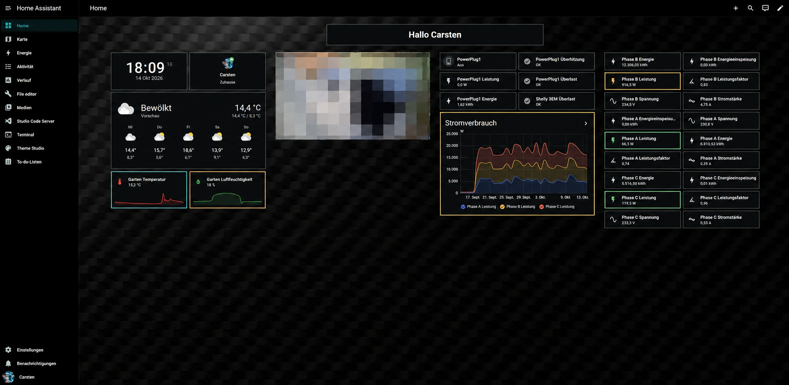 | 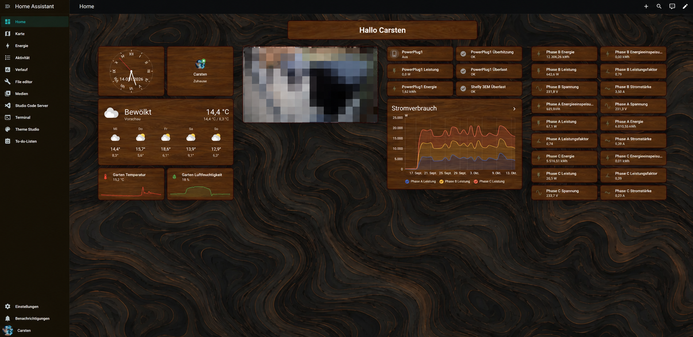 |

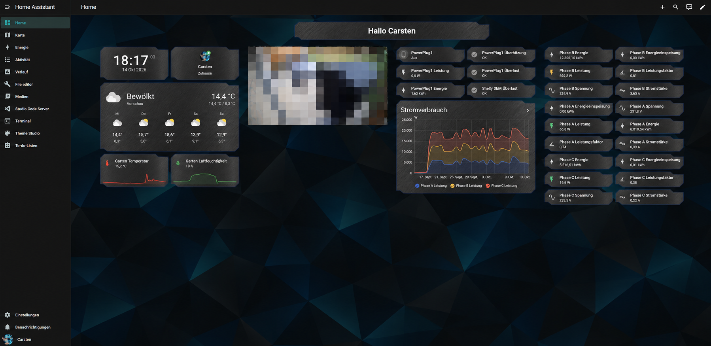

### Design one card without changing the rest

Per-card styling lives inside Home Assistant's regular card editor. A local design can use Standard, Liquid Glass, or Tech Frame styling and can select a color, bundled texture, or custom image. **Save & apply** updates the card and closes the editor, while cards without an override continue to use the global design.

<p align="center">
  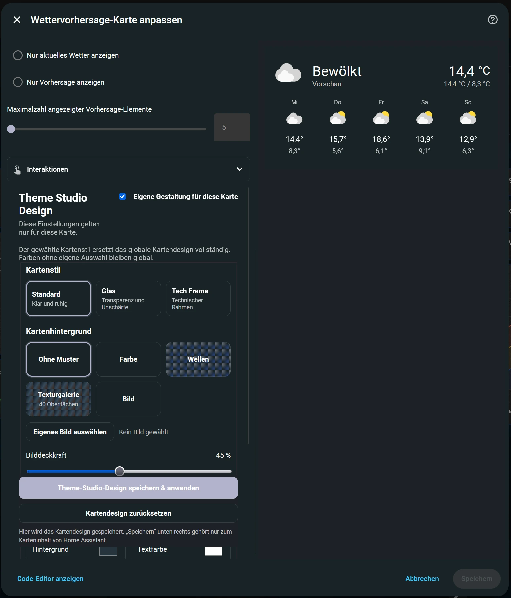
</p>

### A material library made for dashboards

The texture gallery presents every surface with a large preview and an explicit **Apply** action. The same collection is available for dashboard backgrounds and card backgrounds.

| Carbon | Metal |
| --- | --- |
| 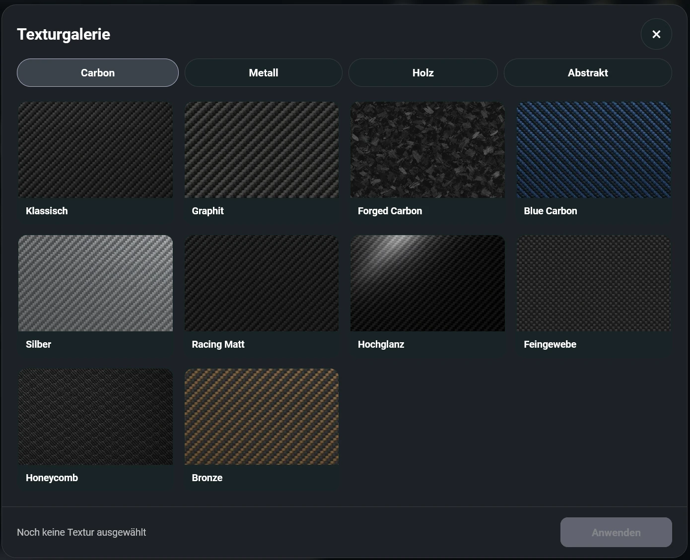 | 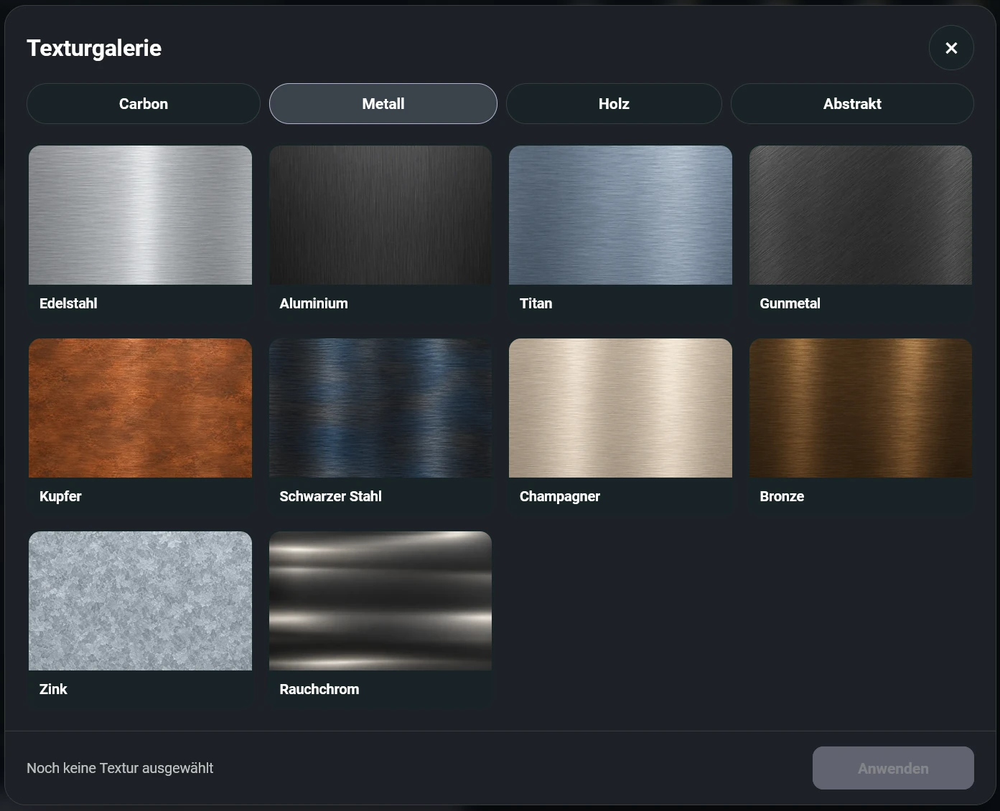 |

| Wood | Abstract |
| --- | --- |
| 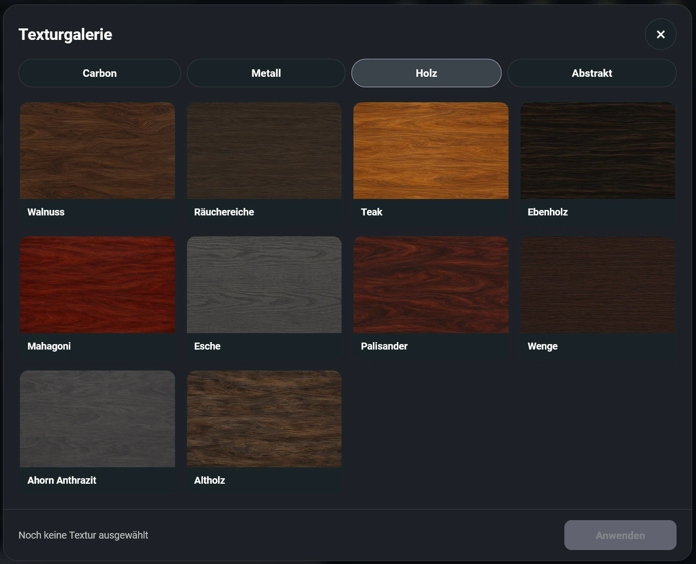 | 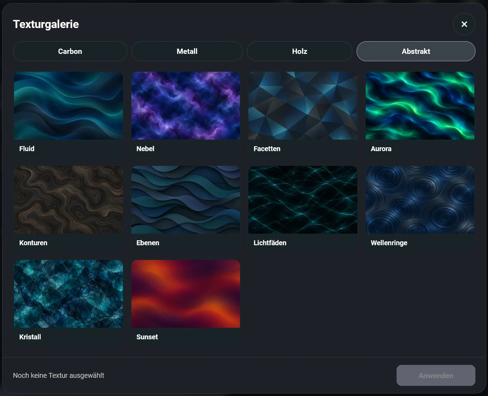 |

### A clock that behaves like a card

The Theme Studio Clock appears in Home Assistant's card picker, so it can be added, moved, resized, and edited like any other dashboard card. Analog and digital display modes are included.

<p align="center">
  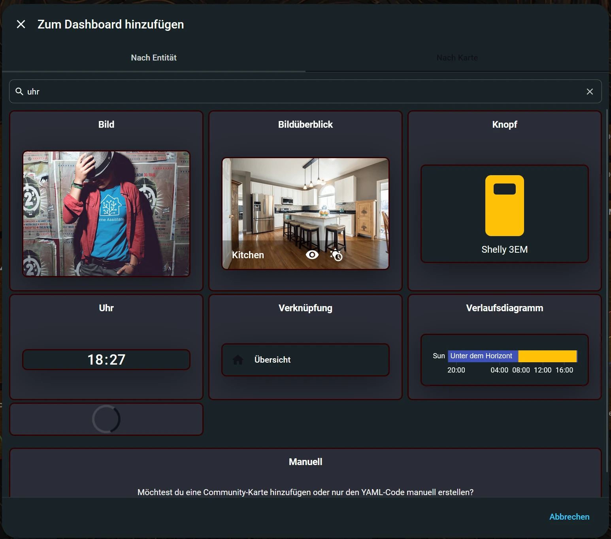
</p>

Each profile is one independent **Light** or **Dark** design. Enter its name and mode under **Create new design**, then edit it directly. **Apply design** activates its palette and fixed mode. There is no mode switch or automatic counterpart generation inside a design.

Legacy profiles are split into two named profiles using their saved colors, without recoloring. Up to 64 designs are supported. The original profile storage is backed up before the first migration write; create a full HA backup before installing or updating.

New JSON exports use single-design format v2. Old v1 imports let you choose one variant. The gallery accepts both formats. Imported designs retain their fixed light/dark mode, and gallery previews are filtered accordingly.

Gallery imports keep the design title as the profile name. The separate mode label is shown only once; older imported names already ending in “Light” or “Dark” are not given a duplicate label.

The gallery automatically follows the mode of the loaded profile. It strictly shows only designs assigned to that mode and imports using the design’s authoritative mode. No missing light or dark palette is generated or recolored. Legacy gallery categories without a clear light/dark assignment remain hidden until they are reclassified.

- save, load, rename, duplicate, and delete custom design profiles
- correct design changes with Undo and Redo
- visible notice for unapplied changes
- brief visual reminder for unsaved profile changes and one green confirmation pulse after saving
- Space Command background effect with stars and light accents, without a visible grid overlay
- optional Liquid Glass card style with a dedicated 0–100% transparency control, backdrop blur, saturation, and reflections; conflicting card material controls are set automatically and locked while glass is active
- optional Tech Frame card style with asymmetric corner cuts, a closed configurable outline, glow intensity, border color, border width, and shadow; headings remain unchanged while normal cards and opaque detail dialogs use the selected frame
- read-only discovery of legacy per-user CSS with safe maintenance and position cleanup for existing profiles
- dashboard effects are automatically disabled in Home Assistant settings under `/config` and in overlay dialogs
- automatic recovery point before applying a design
- restore the last active design with one click, even after a restart
- automatic user interface in German, English, French, or Spanish
- keyboard-accessible controls, visible focus indicators, and an accessible import dialog
- privacy-preserving Home Assistant diagnostics containing technical status and counts only
- action bar remains visible while scrolling for applying changes
- export portable JSON profiles without local entity assignments or background-image paths
- validate and sanitize JSON files on the server before importing them
- clear import preview showing retained design settings and removed local content
- display the installed Theme Studio version directly in the panel
- keep settings, saved profiles, the active design and recovery history separate for every Home Assistant user
- browse verified community designs as complete mini-dashboard previews in light and dark mode and import them as a local profile with one click
- single-row community gallery showing three designs on desktop, with arrow controls and swipe navigation for additional designs
- submit custom designs to [ha-theme-studio.com](https://ha-theme-studio.com/) for review and publication in the community gallery
- configurable primary, background, card, text, icon, and border colors
- separate header and sidebar design for each color mode
- custom navigation background, text, icon, and selected-item colors
- configurable card radius, opacity, texture darkening, border width, and shadow
- global card textures with optional per-card visual overrides
- bundled high-resolution Carbon, Metal, Wood, and Abstract surface collections
- analog and digital Theme Studio Clock card
- gradients and a library for multiple custom background images
- select, rename, and safely delete background images
- **Space Command** dashboard background effect
- freely combinable card effects:
  - **Status Pulse** for selected entities
  - **Energy Flow** for power sensors with warning and critical thresholds
  - **Climate Aura** for temperature and humidity sensors
  - **Alert Focus** for alarm, problem, and battery sensors
- search and multiple selection in every entity list
- selected-entity count
- persistent storage of effect entity selections
- persistent storage of all settings in Home Assistant
- generation and direct activation of a real Home Assistant theme
- safe return to the original Home Assistant default design
- responsive operation on desktop, tablet, and smartphone

Theme Studio settings, profiles, the active design, and the recovery point are private to each Home Assistant user. On first use after updating from 0.6.4, the existing design is copied into that user's private workspace. The background-image library remains shared across the Home Assistant instance and can be managed by administrators; every user can select an available shared image.

## Screenshots

### Fine-tuning

| Global card materials | Background and image library |
| --- | --- |
| 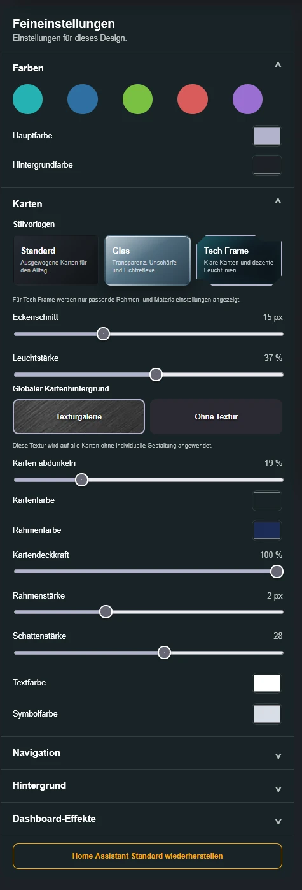 | 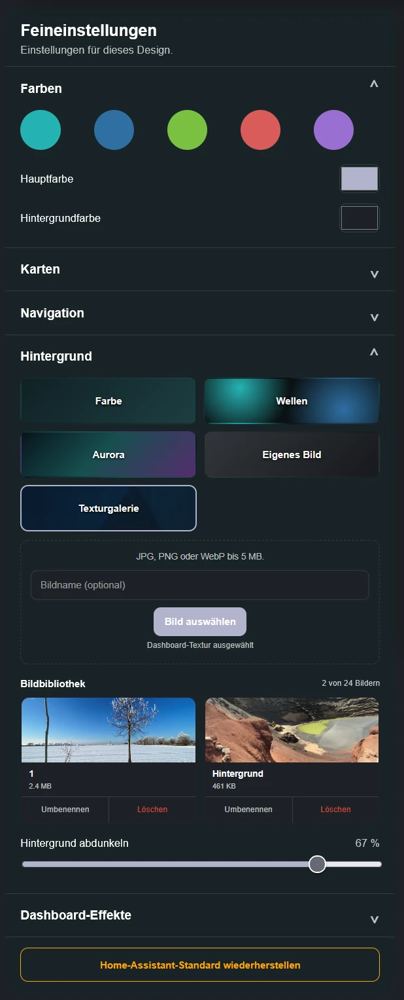 |

Theme Studio still includes detailed navigation styling, profile management, the Community Gallery, custom background libraries, and entity-based Status Pulse, Energy Flow, Climate Aura, and Alert Focus effects.

## Publish your own design

Custom design profiles can be submitted directly to [ha-theme-studio.com](https://ha-theme-studio.com/) for inclusion in the community gallery. Export the profile from Theme Studio as a portable JSON file, sign in to the website with a GitHub account, and upload it through **Submit design**. Local background-image paths, dashboard effects, and entity assignments are not exported. When importing locally, Theme Studio first displays a validated preview and only saves the profile after explicit confirmation. Every submission is reviewed before publication to keep the public gallery organized and consistently high quality.

## Installation through HACS

Theme Studio can be installed as a custom repository through HACS:

1. Open **Integrations** in HACS.
2. Open the three-dot menu in the top-right corner and select **Custom repositories**.
3. Enter `https://github.com/CjonesLAB/ha-theme-studio` as the repository URL.
4. Select **Integration** as the category and add the repository.
5. Open **Theme Studio** in HACS and download the current version.
6. Restart Home Assistant.
7. Go to **Settings → Devices & services → Add integration**, search for **Theme Studio**, and add the integration.

Theme Studio will then appear in the sidebar.

Theme Studio registers its dashboard effect module automatically. No `frontend.extra_module_url` entry is required.

## Manual installation

1. Copy the `custom_components/theme_studio` directory from the current release to Home Assistant:

   ```text
   /config/custom_components/theme_studio
   ```

2. Enable themes in `/config/configuration.yaml`:

   ```yaml
   frontend:
     themes: !include_dir_merge_named themes
   ```

3. Check the configuration and restart Home Assistant:

   ```bash
   ha core check
   ha core restart
   ```

4. Go to **Settings → Devices & services → Add integration**, search for **Theme Studio**, and add the integration.

5. Theme Studio will then appear in the sidebar.

## Usage

1. Open **Theme Studio** from the sidebar.
2. Choose a verified design in the **Community Gallery** and select **Import with one click**, or load one of your own profiles.
3. Choose a saved design, or create a new design with a name and a fixed Light/Dark mode.
4. Adjust colors, cards, navigation, and the background in the fine-tuning section.
5. Enable the desired effects under **Dashboard effects**.
6. Filter entity lists by name, entity ID, or device class and select multiple suitable entities.
7. Optionally enter a name under **My design profiles** and save the complete design as a reusable profile.
8. Use the permanently visible **Apply design** button to save the settings and activate the theme.

**Restore Home Assistant default** disables Theme Studio and also resets the current user's appearance selection to Home Assistant's default in Auto mode. The native Auto/Light/Dark choices are then available again. Saved design profiles and background images are retained. Older installations left with Theme Studio selected after a restore are repaired automatically when the panel opens.

Before applying a changed design, Theme Studio automatically saves the currently active state. **Restore last design** can reactivate this state even after a restart. The state replaced during restoration becomes the new recovery point, allowing you to switch between both states.

Saved profiles can be loaded, updated, renamed, duplicated, or deleted. The profile most recently activated with **Apply design** is selected automatically the next time Theme Studio opens. **Export JSON** saves the portable visual settings, which can be loaded into another Theme Studio installation with **Import JSON**. Installation-specific dashboard effects, entity assignments, and local background-image paths are intentionally excluded.

Dropdown entries use a fixed high-contrast selection color so profile names remain readable even when a very light design is active.

The integrated Community Gallery only displays previously reviewed and published designs from [ha-theme-studio.com](https://ha-theme-studio.com). Every preview represents a complete compact Home Assistant dashboard with header, sidebar, cards, navigation, background, and active card effects. Preview cards follow the light/dark selection at the top. During import, Home Assistant validates the profile again and then stores it in the local design profiles. The creator's background-image paths are not imported because the corresponding local image does not exist on your system.

Up to 24 JPG, PNG, or WebP files can be managed under **Background → Image library**. Existing Theme Studio images are detected automatically. An image used by the active design or a saved profile is protected against accidental deletion.

Card effects are only applied to the selected entities. This keeps large dashboards clear and avoids unnecessary effects.

### Expert CSS

In version 0.9, the legacy CSS section is shown only when the selected profile already contains custom CSS or visual rules from an older release. Existing data remains private to the current Home Assistant user and is never changed automatically.

> **Experimental legacy feature:** Existing appearance rules can be enabled, disabled, edited, or deleted. Version 0.9 no longer offers new rules, duplicates, CSS examples, or card positions. Existing X/Y offsets can be removed with **Disable all position adjustments** without changing the remaining card values.

> **Compatibility:** Card effects and Expert CSS rely on the standard Lovelace card structure. Fully custom dashboards or custom panels that render their own HTML or web-component structure are not supported by these features. Theme colors and compatible Home Assistant theme variables may still apply, but card effects cannot be guaranteed there.

The visual rule list continues to maintain existing appearance adjustments. Use Home Assistant’s own dashboard editor for card order, sections, and layout. Profiles without legacy CSS do not show this section.

Theme Studio exposes stable targeting attributes inside the dashboard:

```css
/* A card containing a specific entity */
ha-card[data-theme-studio-entity~="sensor.house_power"] {
  min-height: 120px;
}

/* Position or resize the outer dashboard item */
[data-theme-studio-card-container][data-theme-studio-id="energy"] {
  grid-column: span 2;
  margin: 0 !important;
}

/* Reduce empty space in detected dashboard layouts */
[data-theme-studio-layout] {
  gap: 6px !important;
}
```

For an unambiguous ID, add `theme_studio_id: energy` to the card's YAML configuration. IDs may contain letters, numbers, underscores, and hyphens. External `@import` rules, remote/data URLs, and executable legacy CSS constructs are rejected. Expert CSS is intentionally omitted from portable profile exports.

## Updating

### Through HACS

Install the update in HACS and restart Home Assistant afterward.

### Manually

Replace the complete `custom_components/theme_studio` directory with the files from the new release and restart Home Assistant.

After every update, reload the Home Assistant interface completely:

- Desktop: `Ctrl + F5`
- Companion App: close the app completely and reopen it

The current version is available on the [Releases page](https://github.com/CjonesLAB/ha-theme-studio/releases/latest).

## Automated tests

For every push and pull request, GitHub automatically checks:

- syntax of all Python and JavaScript files
- safe sanitization of portable profile imports
- removal of local background-image paths, effects, and entity assignments
- rejection of damaged settings and recovery data
- persistent storage and mutual swapping of two recovery points
- sanitization, sorting, and limiting of saved design profiles
- safe validation and caching of public gallery data
- detection, listing, and protection of local background images
- migration of older settings and effect formats

The tests run directly against Home Assistant 2026.8.1 and do not require a complete Home Assistant test instance.

Run the tests locally with Python 3.14:

```bash
python -m pip install --requirement requirements_test.txt
python -m pytest
```

## Generated data

Theme Studio creates or manages the following local files:

```text
/config/themes/theme_studio.yaml
/config/www/theme_studio/
/config/.storage/theme_studio.settings
/config/.storage/theme_studio.profiles
/config/.storage/theme_studio.backgrounds
```

These user-specific files are not part of the GitHub repository and are not overwritten by updates.

## Privacy

Design editing, theme generation, profiles, and custom background images remain local in Home Assistant. To display and import the optional Community Gallery, Home Assistant establishes an HTTPS connection to `ha-theme-studio.com`. Technically necessary connection data, such as the IP address, may be recorded in server logs. Home Assistant credentials, entity states, and local background images are not transmitted.

The diagnostic download available through Home Assistant intentionally contains no colors, design values, entity IDs, profile names, background names or paths, credentials, or stored designs. It reports only the Theme Studio version, storage format versions, storage validity, feature availability, and anonymous counts. Open **Settings → Devices & services → Theme Studio → Download diagnostics** to create the file for a support request.

## Reporting issues

Report bugs and improvement suggestions through the [GitHub issue tracker](https://github.com/CjonesLAB/ha-theme-studio/issues).

Whenever possible, include your Home Assistant version, Theme Studio version, platform, and relevant log messages.

## Development transparency

Parts of the development, review, testing, and documentation were assisted by OpenAI Codex. Commits created with this assistance use the trailer `Assisted-by: OpenAI Codex`. This notice does not represent a GitHub collaborator account or grant repository access.

## License

Theme Studio is released under the [MIT License](LICENSE).
