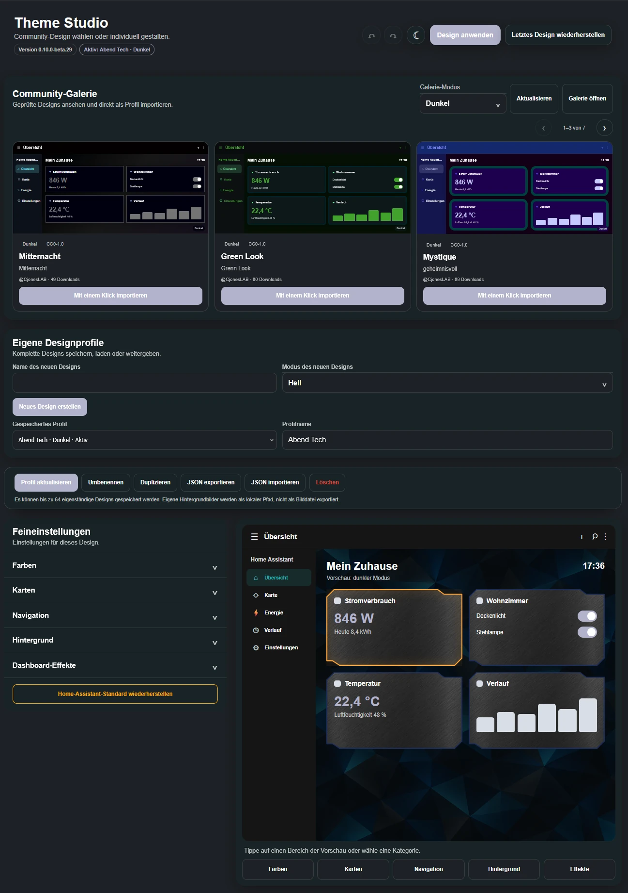

# Theme Studio 0.10.0 - Benutzerhandbuch

[English](USER_GUIDE.en.md) | **Deutsch** | [Français](GUIDE_UTILISATEUR.fr.md) | [Español](GUIA_USUARIO.es.md)

[PDF herunterladen](../downloads/theme-studio-benutzerhandbuch-de.pdf) | [Aktuelle Version](https://github.com/CjonesLAB/ha-theme-studio/releases/latest) | [Fehler melden](https://github.com/CjonesLAB/ha-theme-studio/issues)

Dieses Handbuch erklärt Theme Studio vollständig - von der Installation bis zur mobilen visuellen Dashboard-Gestaltung und sicheren Verwaltung vorhandener Altregeln. Es gilt für Version **0.10.0**.

> Vor Installation, Update oder größeren Designänderungen immer ein vollständiges Home-Assistant-Backup erstellen.



## Inhalt

1. Voraussetzungen und Kompatibilität
2. Installation
3. Erster Start und Bedienoberfläche
4. Community-Galerie
5. Eigene Designprofile
6. Farben, Karten, Navigation und Hintergrund
7. Dashboard- und Karteneffekte
8. Legacy-CSS und alte Positionsregeln
9. Anwenden, Rückgängig, Wiederherstellen und Zurücksetzen
10. JSON-Import, Export und Veröffentlichung
11. Administratorbezogene Einstellungen, Daten und Datenschutz
12. Aktualisierung
13. Fehlerbehebung und bewährte Vorgehensweise

### Neu in 0.10.0

Version 0.10.0 ergänzt 40 mitgelieferte Texturen aus den Bereichen Carbon, Metall, Holz und Abstrakt. Sie lassen sich für den Dashboard-Hintergrund, global für alle Karten oder als individuelles Kartendesign direkt im normalen Home-Assistant-Karteneditor einsetzen. Globale Regler für Abdunklung und Deckkraft sichern die Lesbarkeit. Die neue Theme-Studio-Uhr wird als echte analoge oder digitale Karte über die normale Kartenauswahl hinzugefügt. Rahmen von Karteneffekten liegen nun innerhalb der Karte und sind auf 2 px begrenzt.

## 1. Voraussetzungen und Kompatibilität

Theme Studio ist eine benutzerdefinierte Home-Assistant-Integration. Für die Installation und die tägliche Gestaltung werden Administratorrechte benötigt, weil beim Anwenden eines Designs die erzeugte Theme-Datei geschrieben und die Home-Assistant-Themes neu geladen werden.

Theme Studio erzeugt ein echtes Home-Assistant-Theme. Farben und kompatible Theme-Variablen können daher auf vielen Seiten wirken. Karteneffekte und Experten-CSS benötigen jedoch die übliche **Lovelace-Kartenstruktur**.

> **Wichtige Einschränkung:** Vollständig selbst entwickelte Dashboards oder Custom Panels, die ihre eigene HTML- oder Web-Component-Struktur erzeugen, werden von Karteneffekten und Legacy-CSS nicht unterstützt. Grundfarben können dort weiterhin funktionieren, die Effekte sind aber nicht gewährleistet.

Zusätzlich gilt:

- Dashboard-Effekte werden in Home-Assistant-Einstellungen unter `/config` und in Dialogfenstern nicht angewendet.
- Die Systemoption **Bewegung reduzieren** deaktiviert animierte Effekte automatisch.
- Expertenregeln können nach einem Home-Assistant-Update angepasst werden müssen.
- Oberfläche und Bedienung sind für Desktop, Tablet und Smartphone ausgelegt.

## 2. Installation

### 2.1 Empfohlen: Installation über HACS

[](https://my.home-assistant.io/redirect/hacs_repository/?owner=CjonesLAB&repository=ha-theme-studio&category=integration)

[](https://my.home-assistant.io/redirect/config_flow_start/?domain=theme_studio)

Danach erscheint **Theme Studio** für Home-Assistant-Administratoren in der Seitenleiste. Das Modul für Dashboard-Effekte wird automatisch registriert. Ein Eintrag unter `frontend.extra_module_url` ist nicht erforderlich.

### 2.2 Manuelle Installation

1. Das Installationspaket der aktuellen GitHub-Version herunterladen.
2. Den enthaltenen Ordner `theme_studio` nach `/config/custom_components/theme_studio` kopieren.
3. Sicherstellen, dass Themes in `/config/configuration.yaml` aktiviert sind:

```yaml
frontend:
  themes: !include_dir_merge_named themes
```

4. Die Konfiguration prüfen und Home Assistant neu starten.
5. Theme Studio anschließend unter **Einstellungen -> Geräte & Dienste** als Integration hinzufügen.

Nach einer Installation oder Aktualisierung den Browser mit `Strg + F5` vollständig neu laden. In der Companion App die App vollständig schließen und erneut öffnen.

## 3. Erster Start und Bedienoberfläche

Mit einem Home-Assistant-Administratorkonto anmelden und Theme Studio über den Eintrag in der Seitenleiste öffnen. Oben befinden sich die wichtigsten Aktionen:

- **Rückgängig / Wiederholen:** noch nicht angewendete Bearbeitungsschritte korrigieren.
- **Design anwenden:** aktuelle Werte speichern, Theme erzeugen und für den aktuellen Administrator aktivieren.
- **Letztes Design wiederherstellen:** zum automatisch gesicherten vorherigen Stand wechseln.
- **Versionsanzeige:** zeigt die installierte Theme-Studio-Version.

Die Seite gliedert sich in drei Hauptbereiche:

1. **Community-Galerie** für geprüfte Designs.
2. **Eigene Designprofile** zum Speichern und Austauschen kompletter Designs.
3. **Feineinstellungen** mit Farben, Karten, Navigation, Hintergrund und Effekten.

Die Vorschau reagiert sofort auf Änderungen. Das echte Home-Assistant-Theme ändert sich erst nach **Design anwenden**. Ein sichtbarer Hinweis erinnert an noch nicht angewendete oder noch nicht im Profil gespeicherte Änderungen.


Auf dem Smartphone ist die Vorschau der Ausgangspunkt: Tippe auf **Farben**, **Karten**, **Navigation**, **Hintergrund** oder **Effekte**. Während die Einstellungen darunter gescrollt werden, bleibt eine kompakte Vorschau oben sichtbar. **Zur Vorschau** führt zurück zur Bereichsauswahl. Nach **Design anwenden** wird das gewählte Profil gespeichert und aktiviert; anschließend erscheint wieder die Bereichsauswahl. Auf dem Desktop stehen Vorschau und Einstellungen nebeneinander.

## 4. Community-Galerie

Die Galerie lädt geprüfte Designs von [ha-theme-studio.com](https://ha-theme-studio.com/). Die Vorschau zeigt ein kompaktes Dashboard und folgt dem hellen oder dunklen Modus des ausgewählten Designs.

So wird ein Design übernommen:

1. Galerie bei Bedarf mit **Aktualisieren** neu laden.
2. Mit Pfeilen oder Wischgeste durch weitere Designs wechseln.
3. Beim gewünschten Eintrag **Mit einem Klick importieren** wählen.
4. Das importierte Profil unter **Eigene Designprofile** auswählen.
5. **Design anwenden** drücken.

Galerieprofile werden vor dem Speichern erneut validiert. Lokale Bildpfade des Erstellers werden nicht übernommen, da die Bilddateien auf der eigenen Installation nicht vorhanden sind.

## 5. Eigene Designprofile

Ein Profil ist immer genau **ein helles oder ein dunkles Design**. Es gibt innerhalb eines Profils keine automatische Gegenvariante.

### Neues Profil erstellen

1. Einen eindeutigen Namen eingeben.
2. Als Modus **Hell** oder **Dunkel** wählen.
3. **Neues Design erstellen** drücken.
4. Das Design in den Feineinstellungen bearbeiten.
5. **Design anwenden**. Das ausgewählte Profil wird dabei automatisch gespeichert und anschließend aktiviert.

### Vorhandene Profile verwalten

- **Laden:** Profilwerte in den Editor übernehmen.
- **Profil aktualisieren:** aktuelle Änderungen in das ausgewählte Profil schreiben.
- **Umbenennen:** nur den Profilnamen ändern.
- **Duplizieren:** eine unabhängige Kopie als Ausgangspunkt erzeugen.
- **Löschen:** Profil entfernen; das derzeit aktive Theme bleibt bis zur nächsten Anwendung bestehen.

Auf kleinen Bildschirmen werden nur die für die laufende Gestaltung wichtigen Aktionen gezeigt. **Duplizieren**, **JSON exportieren** und **JSON importieren** stehen in der Desktop-Ansicht zur Verfügung.

Es können bis zu 64 eigenständige Designs gespeichert werden. Das zuletzt angewendete Profil wird beim nächsten Öffnen automatisch ausgewählt.

## 6. Farben, Karten, Navigation und Hintergrund

### 6.1 Farben

Unter **Farben** stehen eine Hauptfarbe, vordefinierte Farbakzente sowie Hintergrundfarben zur Verfügung. Farbfelder öffnen den nativen Farbwähler. Prüfe helle und dunkle Textkontraste in der Vorschau, bevor das Design angewendet wird.

### 6.2 Karten


Es gibt drei Kartenstile:

- **Standard:** klassische Home-Assistant-Karten ohne Glasfilter.
- **Glas:** transparente Karten mit Unschärfe, Sättigung und Lichtreflexen. Theme Studio steuert dabei widersprüchliche Materialwerte automatisch und fällt bei nicht unterstützten Browserfunktionen auf eine ruhigere Darstellung zurück.
- **Tech Frame:** asymmetrisch geschnittene Ecken mit geschlossener Kontur, einstellbarem Leuchten, Rahmen und Schatten.

Je nach Stil können Eckenradius beziehungsweise Eckenschnitt, Kartenfarbe, Text- und Symbolfarbe, Rahmenfarbe, Deckkraft, Rahmenstärke, Schatten, Unschärfe und Leuchtstärke eingestellt werden.

### 6.3 Navigation


Kopfzeile und Seitenleiste lassen sich mit eigenen Hintergrund-, Text-, Symbol- und Akzentfarben gestalten. Der aktive Menüpunkt kann gesondert hervorgehoben werden. Änderungen sollten bei geöffneter und eingeklappter Seitenleiste geprüft werden.

### 6.4 Hintergrund


Zur Verfügung stehen einfarbige Flächen, Farbverläufe und eigene Bilder. In der Bildbibliothek können bis zu 24 JPG-, PNG- oder WebP-Dateien verwaltet werden.

- Nur Administratoren können gemeinsame Hintergrundbilder hinzufügen, umbenennen oder löschen.
- Jeder Administrator kann ein vorhandenes Bild für sein eigenes Design auswählen.
- Bilder, die vom aktiven Design oder einem Profil verwendet werden, sind vor versehentlichem Löschen geschützt.
- Mit **Hintergrund abdunkeln** bleibt Text vor hellen Bildern lesbar.

## 7. Dashboard- und Karteneffekte


### Hintergrundeffekt

**Space Command** erzeugt ein Sternenfeld mit Lichtakzenten. Der Effekt gilt in hellem und dunklem Modus, bleibt aber bei aktivierter Systemoption **Bewegung reduzieren** ausgeschaltet.

### Karteneffekte

Karteneffekte werden nur auf ausgewählte Entitäten angewendet:

- **Status Pulse:** pulsierende Hervorhebung für Statuswerte.
- **Energy Flow:** energieabhängige Darstellung für Leistungssensoren; Warn- und Kritisch-Schwellenwerte sind einstellbar.
- **Climate Aura:** temperatur- oder feuchteabhängige Akzentfarben.
- **Alarm-Fokus:** auffällige Markierung für Alarm-, Problem- und Batteriesensoren.

Entitäten lassen sich nach Name, Entitäts-ID oder Geräteklasse suchen. Mehrere Treffer können gleichzeitig gewählt werden. **Alle Karteneffekte ausschalten** entfernt die Zuweisungen.

Wenn eine Karte keine Standard-Lovelace-Struktur besitzt, kann Theme Studio die zugehörige Entität eventuell nicht erkennen. In vollständig eigenen Dashboards sind diese Effekte nicht nutzbar.

## 8. Legacy-CSS und alte Positionsregeln

Version 0.9 kehrt für neue Designs vollständig zum No-Code-Prinzip zurück. Der CSS-Bereich wird nur angezeigt, wenn das geladene Profil bereits freies CSS oder visuelle Regeln aus einer älteren Theme-Studio-Version enthält. Ohne Altlasten bleibt der Bereich verborgen.

> **Kompatibilitätsprinzip:** Vorhandene CSS-Daten werden beim Laden oder Speichern nicht automatisch verändert oder gelöscht. Neue CSS-Regeln, Duplikate und Kartenpositionen werden in Version 0.9 jedoch nicht mehr angelegt.

Vorhandene visuelle Regeln können aktiviert, deaktiviert, bearbeitet oder gelöscht werden. Vorhandenes freies CSS kann gewartet, deaktiviert oder geleert werden. Alles gilt weiterhin nur für das aktuelle Administratorkonto.

### 8.1 Alte Positionsanpassungen deaktivieren

Theme Studio erkennt Regeln aus älteren Versionen, die X/Y-Werte enthalten, und zeigt **Alte Positionsregeln erkannt** an.

1. Das betroffene Design vor der Änderung prüfen.
2. **Alle Positionsanpassungen deaktivieren** auswählen.
3. Die Sicherheitsabfrage bestätigen.
4. Das Design anwenden.

Entfernt werden ausschließlich horizontale und vertikale Verschiebungen. Innenabstand, Breite, Mindesthöhe, Spaltenbreite, Deckkraft, Schriftgröße, Rundung, Ziel und Gerätebegrenzung bleiben unverändert. Die gespeicherten Regeln werden nicht gelöscht.

### 8.2 Kartenlayout bearbeiten

Zum Verschieben von Karten sowie zum Ändern von Abschnitten, Größe und Layout wird der normale Dashboard-Editor von Home Assistant verwendet. Dadurch bleibt das Dashboard responsiv und nutzt die von Home Assistant unterstützten Layoutregeln auf Desktop, Tablet und Smartphone.

### 8.3 Vorhandene Regeln und freies CSS warten

Der Regel-Editor öffnet sich nur über **Bearbeiten** an einer bereits vorhandenen Regel. Die bisherigen Ziel- und Gerätebegrenzungen bleiben erhalten. `@import`, Remote- und Data-URLs sowie ausführbare veraltete CSS-Konstrukte werden weiterhin abgewiesen. Wenn ein altes Profil Probleme verursacht, zuerst die betroffene Regel deaktivieren oder das Legacy-CSS für dieses Profil ausschalten. Portable JSON-Exporte enthalten diese Altlasten bewusst nicht.

## 9. Anwenden, Rückgängig, Wiederherstellen und Zurücksetzen

- **Rückgängig / Wiederholen** betrifft aktuelle Bearbeitungsschritte im geöffneten Editor.
- **Profil aktualisieren** speichert Änderungen im ausgewählten Profil, ohne das Theme zu aktivieren.
- **Design anwenden** speichert das ausgewählte Profil automatisch, erzeugt das Theme und aktiviert es für den aktuellen Administrator. Auf dem Smartphone kehrt Theme Studio danach zur Vorschau und Bereichsauswahl zurück.
- Vor jeder Anwendung wird der bisher aktive Zustand als Wiederherstellungspunkt gesichert.
- **Letztes Design wiederherstellen** tauscht den aktiven Stand mit dem Wiederherstellungspunkt. Dadurch kann zwischen beiden Zuständen gewechselt werden.
- **Home-Assistant-Standard wiederherstellen** deaktiviert Theme Studio für den aktuellen Administrator und setzt die Darstellung auf Home Assistant **Auto** zurück. Profile und Hintergrundbilder bleiben erhalten.

Wenn die Vorschau richtig aussieht, das echte Dashboard aber unverändert bleibt, wurde meistens **Design anwenden** noch nicht gedrückt oder der Browser benötigt einen vollständigen Reload.

## 10. JSON-Import, Export und Veröffentlichung

### Export

**JSON exportieren** erstellt eine portable Profildatei mit Farben, Karten-, Navigations- und Hintergrundeinstellungen.

Bewusst nicht enthalten sind:

- lokale Hintergrundbild-Dateien und deren lokale Pfade
- Dashboard- und Karteneffekte
- ausgewählte Entitäten
- Experten-CSS und visuelle CSS-Regeln

Diese Daten sind installations- oder benutzerspezifisch und könnten auf einem anderen System falsche Ziele ansprechen.

### Import

1. **JSON importieren** wählen.
2. Datei auswählen; maximale Größe ist 1 MB.
3. Die geprüfte Importvorschau kontrollieren.
4. Import ausdrücklich bestätigen.
5. Neues Profil auswählen und **Design anwenden**.

### Eigenes Design veröffentlichen

Ein exportiertes Profil kann auf [ha-theme-studio.com](https://ha-theme-studio.com/) über **Design einreichen** hochgeladen werden. Die Anmeldung erfolgt mit GitHub. Jedes Design wird vor Aufnahme in die öffentliche Galerie geprüft.

## 11. Administratorbezogene Einstellungen, Daten und Datenschutz

Seit Version 0.7.0 besitzt jeder Home-Assistant-Administrator eigene Einstellungen, Profile, ein aktives Design, Expertenregeln und Wiederherstellungspunkte. Mehrere Administratoren überschreiben ihre gespeicherten Designs nicht gegenseitig. Die Bildbibliothek bleibt gemeinsam und wird von Administratoren verwaltet.

Theme Studio speichert seine Daten lokal in Home Assistant, unter anderem in:

```text
/config/themes/theme_studio.yaml
/config/www/theme_studio/
/config/.storage/theme_studio.settings
/config/.storage/theme_studio.profiles
/config/.storage/theme_studio.backgrounds
```

Nur die optionale Community-Galerie verbindet sich per HTTPS mit `ha-theme-studio.com`. Zugangsdaten, Entitätszustände und lokale Hintergrundbilder werden nicht übertragen. Der Home-Assistant-Diagnosedownload enthält nur technische Zustände und anonyme Anzahlen, keine Farben, Profilnamen, Entitäts-IDs oder Zugangsdaten.

## 12. Aktualisierung

### HACS

1. Update in HACS installieren.
2. Home Assistant neu starten.
3. Oberfläche mit `Strg + F5` neu laden beziehungsweise Companion App neu starten.

### Manuell

Den vollständigen Ordner `/config/custom_components/theme_studio` durch den Ordner aus dem neuen Release ersetzen. Keine Einzeldateien mischen. Danach Home Assistant und die Oberfläche neu starten.

Gespeicherte Profile und Administratoreinstellungen werden bei normalen Updates nicht überschrieben. Ein Backup bleibt trotzdem erforderlich.

## 13. Fehlerbehebung und bewährte Vorgehensweise

| Problem | Lösung |
| --- | --- |
| Theme Studio fehlt in der Seitenleiste | Integration unter **Einstellungen -> Geräte & Dienste** hinzufügen und Home Assistant neu starten. |
| Änderungen erscheinen nur in der Vorschau | **Design anwenden** drücken. |
| Alte Oberfläche nach einem Update | Browser mit `Strg + F5` neu laden; Companion App vollständig beenden. |
| Effekte fehlen | Prüfen, ob ein Lovelace-Dashboard, passende Entitäten und keine Option **Bewegung reduzieren** verwendet werden. |
| Effekte fehlen in eigenem Dashboard | Vollständig eigene Dashboards und Custom Panels werden für Karteneffekte nicht unterstützt. |
| Legacy-CSS-Bereich fehlt | Er erscheint in Version 0.9 nur bei Profilen, die bereits alte CSS-Daten enthalten. |
| Karte springt oder ist unbedienbar | Betroffene Altregel deaktivieren oder nur deren alte Positionswerte entfernen. |
| Hintergrundbild lässt sich nicht löschen | Das Bild wird noch von einem aktiven Design oder Profil verwendet. |
| Import enthält keine Effekte/CSS | Das ist beabsichtigt; JSON-Profile enthalten nur portable Designwerte. |

Bewährte Reihenfolge für neue Designs:

1. Backup erstellen.
2. Neues Profil mit festem Hell-/Dunkelmodus anlegen.
3. Grundfarben und Navigation festlegen.
4. Kartenstil und Hintergrund einstellen.
5. Design anwenden; das ausgewählte Profil wird dabei automatisch gespeichert.
6. Effekte gezielt wenigen Entitäten zuweisen.
7. Kartenreihenfolge und Layout ausschließlich im Home-Assistant-Dashboard-Editor bearbeiten.
8. Legacy-CSS nur zur Pflege bereits vorhandener Regeln öffnen.

Für Supportanfragen sind Home-Assistant-Version, Theme-Studio-Version, Plattform, betroffene Dashboard-Art und relevante Protokollmeldungen hilfreich. Fehler können im [GitHub-Issue-Tracker](https://github.com/CjonesLAB/ha-theme-studio/issues) gemeldet werden.
