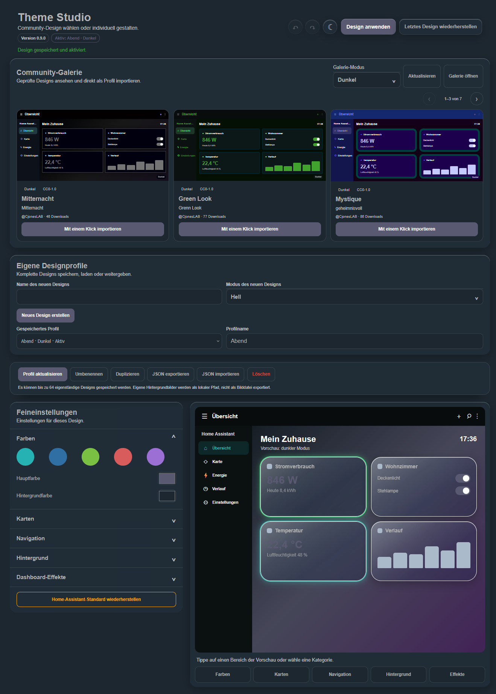

# Theme Studio 0.9.0 - Guía de usuario

[English](USER_GUIDE.en.md) | [Deutsch](BENUTZERHANDBUCH.de.md) | [Français](GUIDE_UTILISATEUR.fr.md) | **Español**

[Descargar PDF](../downloads/theme-studio-guia-usuario-es.pdf) | [Última versión](https://github.com/CjonesLAB/ha-theme-studio/releases/latest) | [Informar de un problema](https://github.com/CjonesLAB/ha-theme-studio/issues)

Esta guía explica Theme Studio, desde la instalación hasta el diseño visual móvil del panel y la gestión segura de las reglas heredadas. Se aplica a la versión **0.9.0**.

> Crea siempre una copia de seguridad completa de Home Assistant antes de instalar, actualizar o realizar cambios importantes en un diseño.



## Contenido

1. Requisitos y compatibilidad
2. Instalación
3. Primer inicio e interfaz
4. Galería de la comunidad
5. Perfiles de diseño
6. Colores, tarjetas, navegación y fondo
7. Efectos del panel y de las tarjetas
8. CSS heredado y reglas de posición antiguas
9. Aplicar, deshacer, restaurar y restablecer
10. Importación, exportación y publicación JSON
11. Ajustes por usuario, datos y privacidad
12. Actualización
13. Solución de problemas y método recomendado

## 1. Requisitos y compatibilidad

Theme Studio es una integración personalizada para Home Assistant. La instalación requiere permisos de administrador. Después, una cuenta de usuario normal es suficiente para crear diseños.

Theme Studio genera un tema real de Home Assistant, por lo que los colores y las variables compatibles pueden actuar en muchas páginas. Sin embargo, los efectos de tarjeta y el CSS experto necesitan la estructura estándar de tarjetas de **Lovelace**.

> **Limitación importante:** los paneles completamente personalizados o los paneles personalizados que generan su propia estructura HTML o sus propios componentes web no son compatibles con los efectos de tarjeta ni el CSS experto. Los colores básicos del tema pueden seguir funcionando, pero los efectos no están garantizados.

Ten en cuenta también:

- Los efectos se desactivan en los ajustes de Home Assistant bajo `/config` y en los cuadros de diálogo.
- La opción del sistema **Reducir movimiento** desactiva automáticamente los efectos animados.
- Las reglas expertas pueden necesitar ajustes después de una actualización de Home Assistant.
- La interfaz se adapta a ordenador, tableta y teléfono.

## 2. Instalación

### 2.1 Recomendado: instalación mediante HACS

1. Abre **Integraciones** en HACS.
2. Abre el menú de tres puntos y selecciona **Repositorios personalizados**.
3. Introduce `https://github.com/CjonesLAB/ha-theme-studio`.
4. Elige la categoría **Integración** y añade el repositorio.
5. Abre **Theme Studio** y descarga la versión actual.
6. Reinicia Home Assistant.
7. Abre **Ajustes -> Dispositivos y servicios -> Añadir integración**.
8. Busca **Theme Studio** y añádelo.

Theme Studio aparecerá en la barra lateral. El módulo de efectos se registra automáticamente; no hace falta añadir `frontend.extra_module_url`.

### 2.2 Instalación manual

1. Descarga el paquete de la última versión de GitHub.
2. Copia la carpeta `theme_studio` en `/config/custom_components/theme_studio`.
3. Comprueba que los temas estén habilitados en `/config/configuration.yaml`:

```yaml
frontend:
  themes: !include_dir_merge_named themes
```

4. Comprueba la configuración y reinicia Home Assistant.
5. Añade Theme Studio desde **Ajustes -> Dispositivos y servicios**.

Después de instalar o actualizar, recarga completamente el navegador con `Ctrl + F5`. Cierra y vuelve a abrir por completo la aplicación Companion.

## 3. Primer inicio e interfaz

Abre Theme Studio desde la barra lateral. Las acciones principales aparecen arriba:

- **Deshacer / Rehacer:** corregir cambios todavía no aplicados.
- **Aplicar diseño:** guardar los valores, generar el tema y activarlo para el usuario actual.
- **Restaurar último diseño:** volver al estado anterior guardado automáticamente.
- **Versión:** mostrar la versión instalada.

La página contiene tres áreas principales:

1. **Galería de la comunidad** con diseños revisados.
2. **Mis perfiles de diseño** para guardar e intercambiar diseños completos.
3. **Ajustes** para colores, tarjetas, navegación, fondo y efectos.

La vista previa reacciona inmediatamente. El tema real de Home Assistant solo cambia al pulsar **Aplicar diseño**. Un aviso muestra los cambios todavía no aplicados o no guardados en el perfil.


En el teléfono, la vista previa es el punto de partida: pulsa **Colores**, **Tarjetas**, **Navegación**, **Fondo** o **Efectos**. Una vista previa compacta permanece visible arriba mientras desplazas los ajustes. **Volver a la vista previa** regresa al selector de secciones. **Aplicar diseño** guarda y activa el perfil seleccionado y después vuelve a la vista previa y al selector. En el escritorio, la vista previa y los ajustes permanecen uno al lado del otro.

## 4. Galería de la comunidad

La galería carga diseños revisados desde [ha-theme-studio.com](https://ha-theme-studio.com/). Cada vista previa muestra un panel compacto y respeta el modo claro u oscuro del diseño.

1. Pulsa **Actualizar** cuando sea necesario.
2. Navega con las flechas o deslizando.
3. Elige **Importar con un clic**.
4. Selecciona el perfil importado en **Mis perfiles de diseño**.
5. Pulsa **Aplicar diseño**.

Los perfiles se validan antes de guardarse. Las rutas de imágenes locales del creador no se importan porque esos archivos no existen en tu instalación.

## 5. Perfiles de diseño

Un perfil representa exactamente **un diseño claro o uno oscuro**. No se genera automáticamente una variante opuesta dentro del mismo perfil.

### Crear un perfil

1. Introduce un nombre único.
2. Elige **Claro** u **Oscuro**.
3. Pulsa **Crear diseño**.
4. Personalízalo en los ajustes.
5. Pulsa **Aplicar diseño**. El perfil seleccionado se guarda automáticamente antes de activarse.

### Gestionar perfiles

- **Cargar:** copiar los valores del perfil al editor.
- **Actualizar perfil:** guardar los cambios actuales en el perfil seleccionado.
- **Renombrar:** cambiar solo el nombre.
- **Duplicar:** crear una copia independiente.
- **Eliminar:** borrar el perfil; el tema activo permanece hasta aplicar otro diseño.

En pantallas pequeñas solo se muestran las acciones necesarias para la edición actual. **Duplicar**, **Exportar JSON** e **Importar JSON** siguen disponibles en la vista de escritorio.

Se pueden almacenar hasta 64 diseños independientes. El último perfil aplicado se selecciona automáticamente la próxima vez.

## 6. Colores, tarjetas, navegación y fondo

### 6.1 Colores

La sección **Colores** ofrece un color principal, acentos predefinidos y colores de fondo. Comprueba el contraste del texto en la vista previa y en el panel real.

### 6.2 Tarjetas


Hay tres estilos:

- **Standard:** tarjetas clásicas sin filtro de cristal.
- **Cristal:** transparencia, desenfoque, saturación y reflejos; los valores incompatibles se controlan automáticamente y se usa una presentación más sencilla si una función del navegador no está disponible.
- **Tech Frame:** esquinas asimétricas, contorno cerrado, brillo, borde y sombra configurables.

Según el estilo, puedes cambiar el radio o corte, color de tarjeta, texto, iconos, borde, opacidad, grosor, sombra, desenfoque y brillo.

### 6.3 Navegación


La cabecera y la barra lateral admiten colores propios para fondo, texto, iconos y acento. Prueba el resultado con la barra lateral abierta y cerrada.

### 6.4 Fondo


Elige un color, degradado o imagen. La biblioteca admite hasta 24 archivos JPG, PNG o WebP.

- Solo los administradores pueden añadir, renombrar o eliminar imágenes compartidas.
- Cada usuario puede elegir una imagen disponible para su diseño personal.
- Una imagen usada por el diseño activo o un perfil está protegida contra el borrado.
- **Oscurecer fondo** mejora la legibilidad sobre imágenes claras.

## 7. Efectos del panel y de las tarjetas


### Efecto de fondo

**Space Command** añade estrellas y acentos luminosos. Funciona en modo claro y oscuro, salvo cuando **Reducir movimiento** está activo.

### Efectos de tarjeta

Los efectos solo se aplican a las entidades seleccionadas:

- **Status Pulse:** pulsación para estados.
- **Energy Flow:** aspecto según el consumo con umbrales de aviso y crítico.
- **Climate Aura:** colores según temperatura o humedad.
- **Alarm Focus:** marca destacada para alarmas, problemas y baterías.

Busca por nombre, ID o clase de dispositivo y selecciona varias entidades. **Desactivar todos los efectos de tarjeta** elimina todas las asignaciones.

Una tarjeta sin estructura Lovelace estándar puede impedir que Theme Studio detecte la entidad. Estos efectos no están disponibles en paneles completamente personalizados.

## 8. CSS heredado y reglas de posición antiguas

La versión 0.9 vuelve por completo al flujo sin código para los diseños nuevos. La sección CSS solo aparece cuando el perfil cargado ya contiene CSS libre o reglas visuales de una versión anterior de Theme Studio. En perfiles sin datos heredados permanece oculta.

> **Principio de compatibilidad:** los datos CSS existentes nunca se cambian ni eliminan automáticamente al cargar o guardar. La versión 0.9 no crea reglas CSS nuevas, copias de reglas ni posiciones de tarjetas.

Las reglas existentes se pueden activar, desactivar, editar o eliminar. El CSS libre existente se puede mantener, desactivar o borrar. Todos estos datos siguen siendo privados para el usuario actual.

### 8.1 Desactivar los ajustes de posición antiguos

Theme Studio detecta las reglas creadas por versiones anteriores que contienen valores X/Y y muestra **Se detectaron reglas de posición antiguas**.

1. Revisa el diseño afectado antes de modificarlo.
2. Selecciona **Desactivar todos los ajustes de posición**.
3. Confirma la pregunta.
4. Aplica el diseño.

Solo se eliminan los desplazamientos horizontales y verticales. El espacio interior, la anchura, la altura mínima, las columnas, la opacidad, el tamaño del texto, las esquinas, el objetivo y la restricción de dispositivo permanecen sin cambios. Las reglas guardadas no se eliminan.

### 8.2 Gestionar el diseño de las tarjetas

Usa el editor nativo de Home Assistant para mover tarjetas, modificar secciones, tamaños o el diseño. De este modo, el panel sigue siendo adaptable y utiliza las reglas de diseño compatibles con Home Assistant en ordenador, tableta y teléfono.

### 8.3 Mantener las reglas y el CSS libre existentes

El editor de reglas solo se abre mediante **Editar** en una regla ya existente. Se mantienen los objetivos y las restricciones de dispositivo anteriores. Se siguen rechazando `@import`, URL remotas/data y construcciones ejecutables antiguas. Si un perfil antiguo causa problemas, desactiva primero la regla afectada o el CSS heredado de ese perfil. Las exportaciones JSON portátiles excluyen estos datos antiguos de forma intencionada.

## 9. Aplicar, deshacer, restaurar y restablecer

- **Deshacer / Rehacer** actúa sobre los cambios actuales.
- **Actualizar perfil** guarda los cambios sin activar el tema.
- **Aplicar diseño** guarda automáticamente el perfil seleccionado, genera el tema y lo activa. En el teléfono, Theme Studio vuelve después a la vista previa y al selector de secciones.
- Antes de cada aplicación, el estado activo se guarda como punto de recuperación.
- **Restaurar último diseño** intercambia el estado activo con ese punto.
- **Restaurar diseño predeterminado de Home Assistant** desactiva Theme Studio para el usuario y vuelve a **Auto**. Los perfiles e imágenes se conservan.

Si la vista previa es correcta pero el panel real no cambia, aplica el diseño o recarga completamente el navegador.

## 10. Importación, exportación y publicación JSON

### Exportación

**Exportar JSON** crea un perfil portátil con colores y ajustes de tarjetas, navegación y fondo.

Se excluyen de forma intencionada:

- archivos y rutas de imágenes locales
- efectos y asignaciones de entidades
- CSS experto y reglas visuales

Estos datos son específicos de la instalación o del usuario.

### Importación

1. Elige **Importar JSON**.
2. Selecciona un archivo de hasta 1 MB.
3. Revisa la vista previa validada.
4. Confirma expresamente.
5. Selecciona el perfil creado y aplícalo.

### Publicación

Un perfil exportado puede enviarse con **Enviar diseño** en [ha-theme-studio.com](https://ha-theme-studio.com/). El inicio de sesión usa GitHub y cada diseño se revisa antes de publicarse.

## 11. Ajustes por usuario, datos y privacidad

Desde la versión 0.7.0, cada usuario tiene ajustes, perfiles, diseño activo, reglas expertas y puntos de recuperación privados. La biblioteca de imágenes sigue compartida y administrada por los administradores.

Los datos permanecen localmente, entre otros lugares en:

```text
/config/themes/theme_studio.yaml
/config/www/theme_studio/
/config/.storage/theme_studio.settings
/config/.storage/theme_studio.profiles
/config/.storage/theme_studio.backgrounds
```

Solo la galería opcional se conecta por HTTPS a `ha-theme-studio.com`. No se transmiten credenciales, estados de entidades ni imágenes locales. El diagnóstico de Home Assistant contiene únicamente estados técnicos y recuentos anónimos.

## 12. Actualización

### HACS

1. Instala la actualización en HACS.
2. Reinicia Home Assistant.
3. Usa `Ctrl + F5` o reinicia la aplicación Companion.

### Manual

Sustituye toda la carpeta `/config/custom_components/theme_studio` por la carpeta de la nueva versión. No mezcles archivos de versiones distintas. Reinicia Home Assistant y la interfaz.

Las actualizaciones normales no sustituyen perfiles ni ajustes personales. Aun así, se recomienda una copia de seguridad.

## 13. Solución de problemas y método recomendado

| Problema | Solución |
| --- | --- |
| Theme Studio no aparece en la barra lateral | Añade la integración en **Ajustes -> Dispositivos y servicios** y reinicia. |
| Los cambios solo aparecen en la vista previa | Pulsa **Aplicar diseño**. |
| Sigue apareciendo la interfaz antigua | Recarga con `Ctrl + F5` o reinicia la aplicación. |
| Faltan los efectos | Usa Lovelace, selecciona entidades compatibles y revisa **Reducir movimiento**. |
| Faltan efectos en un panel propio | Los paneles completamente personalizados no son compatibles con los efectos de tarjeta. |
| Falta la sección de CSS heredado | La versión 0.9 solo la muestra en perfiles que ya contienen datos CSS antiguos. |
| Una tarjeta salta o deja de funcionar | Desactiva la regla heredada afectada o elimina solo sus valores de posición. |
| No se puede eliminar una imagen | Todavía la usa el diseño activo o un perfil. |
| La importación no contiene efectos/CSS | Es normal: los perfiles JSON solo contienen valores portátiles. |

Método recomendado:

1. Crea una copia de seguridad.
2. Crea un perfil claro u oscuro.
3. Configura colores y navegación.
4. Elige estilo de tarjeta y fondo.
5. Aplica el diseño; el perfil seleccionado se guarda automáticamente.
6. Asigna efectos a pocas entidades adecuadas.
7. Gestiona el orden y el diseño de las tarjetas solo en el editor de Home Assistant.
8. Abre el CSS heredado únicamente para mantener reglas ya existentes.

Para solicitar ayuda, incluye las versiones de Home Assistant y Theme Studio, la plataforma, el tipo de panel y los registros relevantes en el [seguimiento de problemas de GitHub](https://github.com/CjonesLAB/ha-theme-studio/issues).
