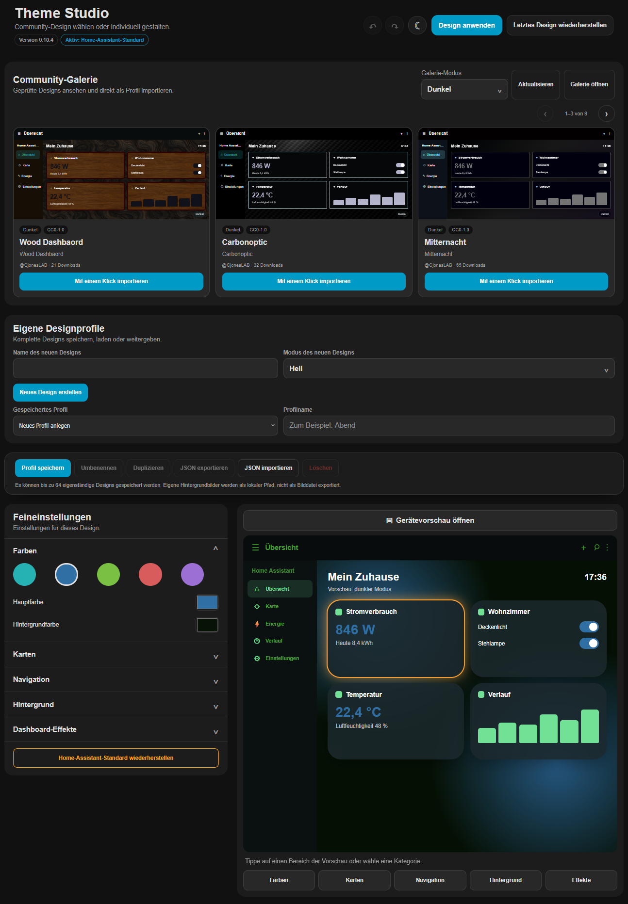
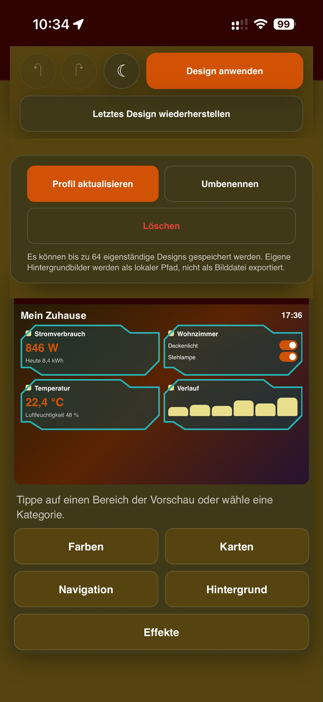
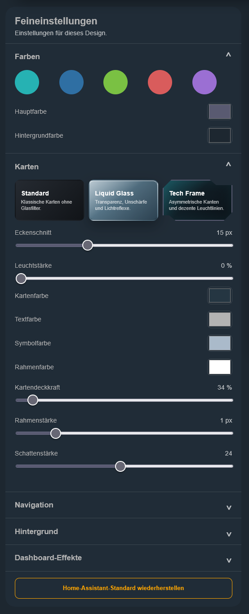
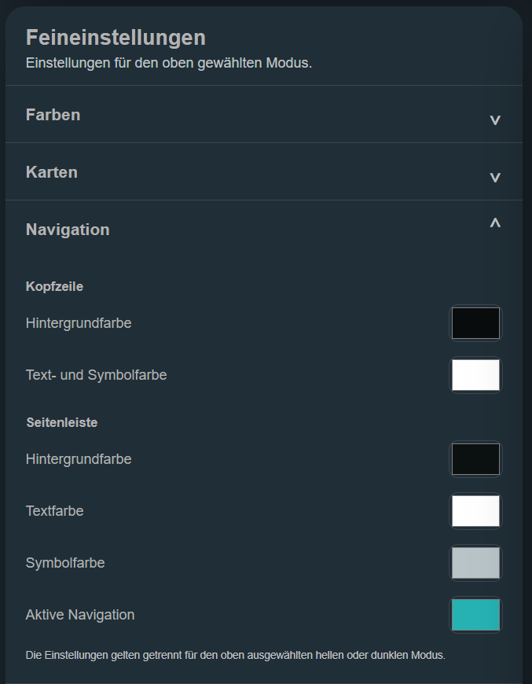
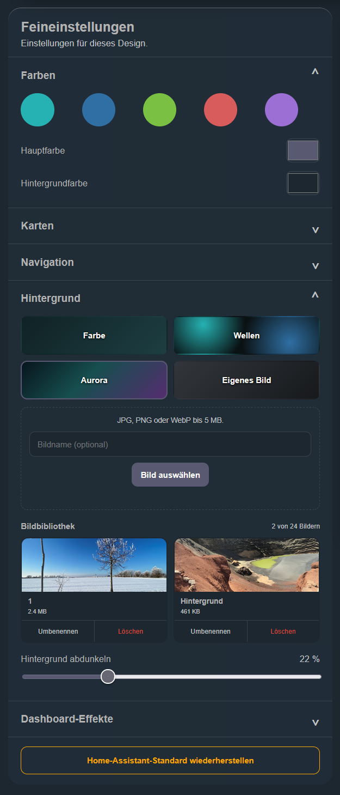
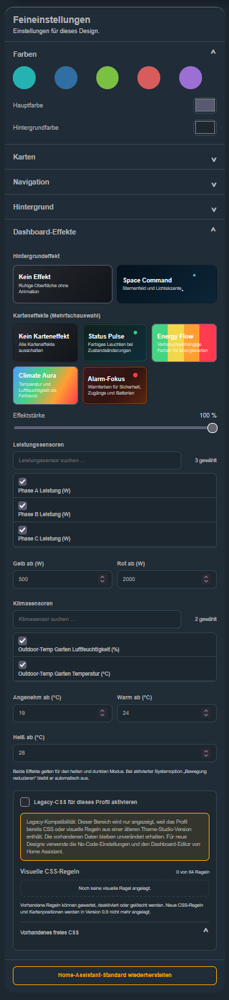

# Theme Studio 0.10.4 - Guide utilisateur

[English](USER_GUIDE.en.md) | [Deutsch](BENUTZERHANDBUCH.de.md) | **Français** | [Español](GUIA_USUARIO.es.md)

[Télécharger le PDF](../downloads/theme-studio-guide-utilisateur-fr.pdf) | [Dernière version](https://github.com/CjonesLAB/ha-theme-studio/releases/latest) | [Signaler un problème](https://github.com/CjonesLAB/ha-theme-studio/issues)

Ce guide présente Theme Studio, de l’installation à la conception visuelle mobile du tableau de bord et à la gestion sûre des anciennes règles. Il s’applique à la version **0.10.4**.

> Créez toujours une sauvegarde complète de Home Assistant avant une installation, une mise à jour ou une modification importante du design.



## Sommaire

1. Prérequis et compatibilité
2. Installation
3. Premier démarrage et interface
4. Galerie communautaire
5. Profils de design
6. Couleurs, cartes, navigation et arrière-plan
7. Effets du tableau de bord et des cartes
8. CSS hérité et anciennes règles de position
9. Appliquer, annuler, restaurer et réinitialiser
10. Importation, exportation et publication JSON
11. Réglages par administrateur, données et confidentialité
12. Mise à jour
13. Dépannage et méthode recommandée

### Nouveautés de la version 0.10.0

La version 0.10.0 ajoute 40 textures Carbon, Métal, Bois et Abstrait. Elles peuvent habiller le tableau de bord, toutes les cartes ou une carte précise depuis l’éditeur natif de Home Assistant. Des réglages globaux d’assombrissement et d’opacité préservent la lisibilité. La nouvelle horloge Theme Studio s’ajoute depuis le sélecteur de cartes, en version analogique ou numérique. Les cadres d’effet restent désormais à l’intérieur des cartes et sont limités à 2 px.

## 1. Prérequis et compatibilité

Theme Studio est une intégration personnalisée Home Assistant. Les droits d’administrateur sont nécessaires pour l’installation et pour toute utilisation quotidienne, car l’application d’un design écrit le fichier de thème généré et recharge les thèmes Home Assistant.

Theme Studio génère un véritable thème Home Assistant. Les couleurs et variables compatibles peuvent donc agir sur de nombreuses pages. Les effets de carte et le CSS expert nécessitent toutefois la structure standard des cartes **Lovelace**.

> **Limitation importante :** les tableaux de bord entièrement personnalisés ou les panneaux personnalisés qui génèrent leur propre structure HTML ou leurs propres composants Web ne sont pas pris en charge par les effets de carte ou le CSS expert. Les couleurs de base du thème peuvent encore fonctionner, mais les effets ne sont pas garantis.

À retenir également :

- Les effets sont désactivés dans les paramètres Home Assistant sous `/config` et dans les dialogues.
- L’option système **Réduire les animations** désactive automatiquement les effets animés.
- Les règles expertes peuvent nécessiter une adaptation après une mise à jour de Home Assistant.
- L’interface s’adapte à l’ordinateur, la tablette et le téléphone.

## 2. Installation

### 2.1 Recommandé : installation avec HACS

[](https://my.home-assistant.io/redirect/hacs_repository/?owner=CjonesLAB&repository=ha-theme-studio&category=integration)

[](https://my.home-assistant.io/redirect/config_flow_start/?domain=theme_studio)

Theme Studio apparaît ensuite dans la barre latérale pour les administrateurs Home Assistant. Le module d’effets est enregistré automatiquement ; aucune entrée `frontend.extra_module_url` n’est nécessaire.

### 2.2 Installation manuelle

1. Téléchargez le paquet de la dernière version GitHub.
2. Copiez le dossier `theme_studio` dans `/config/custom_components/theme_studio`.
3. Vérifiez que les thèmes sont activés dans `/config/configuration.yaml` :

```yaml
frontend:
  themes: !include_dir_merge_named themes
```

4. Vérifiez la configuration et redémarrez Home Assistant.
5. Ajoutez Theme Studio sous **Paramètres -> Appareils et services**.

Après une installation ou une mise à jour, rechargez complètement le navigateur avec `Ctrl + F5`. Fermez et rouvrez entièrement l’application Companion.

## 3. Premier démarrage et interface

Connectez-vous avec un compte administrateur Home Assistant et ouvrez Theme Studio depuis la barre latérale. Les actions principales se trouvent en haut :

- **Annuler / Rétablir :** corriger les modifications non appliquées.
- **Appliquer le thème :** enregistrer les valeurs, générer le thème et l’activer pour l’administrateur actuel.
- **Restaurer le dernier design :** revenir à l’état précédent sauvegardé automatiquement.
- **Version :** afficher la version installée.

La page contient trois zones principales :

1. **Galerie communautaire** pour les designs vérifiés.
2. **Mes profils de design** pour enregistrer et échanger des designs complets.
3. **Réglages** pour les couleurs, cartes, navigation, arrière-plan et effets.

L’aperçu réagit immédiatement. Le véritable thème Home Assistant ne change qu’après **Appliquer le thème**. Un message indique les modifications non appliquées ou non enregistrées dans le profil.



Sur téléphone, l’aperçu est le point de départ : touchez **Couleurs**, **Cartes**, **Navigation**, **Arrière-plan** ou **Effets**. Un aperçu compact reste visible en haut pendant le défilement des réglages. **Retour à l’aperçu** revient au choix des sections. **Appliquer le thème** enregistre et active le profil sélectionné, puis revient à l’aperçu et au choix des sections. Sur ordinateur, l’aperçu et les réglages restent côte à côte.

## 4. Galerie communautaire

La galerie charge des designs vérifiés depuis [ha-theme-studio.com](https://ha-theme-studio.com/). Chaque aperçu montre un tableau de bord compact et respecte le mode clair ou sombre du design.

1. Utilisez **Actualiser** si nécessaire.
2. Parcourez les designs avec les flèches ou un geste de balayage.
3. Choisissez **Importer en un clic**.
4. Sélectionnez le profil importé sous **Mes profils de design**.
5. Appuyez sur **Appliquer le thème**.

Les profils sont validés avant leur enregistrement. Les chemins d’images locaux du créateur ne sont pas importés, car les fichiers correspondants n’existent pas sur votre installation.

## 5. Profils de design

Un profil représente exactement **un design clair ou un design sombre**. Aucune variante opposée n’est générée automatiquement dans le même profil.

### Créer un profil

1. Saisissez un nom unique.
2. Choisissez **Clair** ou **Sombre**.
3. Sélectionnez **Créer un thème**.
4. Personnalisez-le dans les réglages.
5. Sélectionnez **Appliquer le thème**. Le profil choisi est enregistré automatiquement avant son activation.

### Gérer les profils

- **Charger :** placer les valeurs du profil dans l’éditeur.
- **Mettre à jour :** enregistrer les modifications dans le profil sélectionné.
- **Renommer :** changer uniquement son nom.
- **Dupliquer :** créer une copie indépendante.
- **Supprimer :** retirer le profil ; le thème actif reste en place jusqu’à la prochaine application.

Sur petit écran, seules les actions nécessaires à l’édition courante sont affichées. **Dupliquer**, **Exporter JSON** et **Importer JSON** restent disponibles dans la vue ordinateur.

Jusqu’à 64 designs indépendants peuvent être enregistrés. Le dernier profil appliqué est sélectionné automatiquement à la prochaine ouverture.

## 6. Couleurs, cartes, navigation et arrière-plan

### 6.1 Couleurs

La section **Couleurs** propose une couleur principale, des accents prédéfinis et les couleurs d’arrière-plan. Vérifiez le contraste du texte dans l’aperçu puis sur le véritable tableau de bord.

### 6.2 Cartes



Trois styles sont disponibles :

- **Standard :** cartes Home Assistant classiques sans filtre de verre.
- **Verre :** transparence, flou, saturation et reflets ; les valeurs incompatibles sont gérées automatiquement, avec une présentation plus simple si une fonction du navigateur n’est pas disponible.
- **Tech Frame :** coins asymétriques, contour fermé, lueur, bordure et ombre réglables.

Selon le style, vous pouvez régler le rayon ou la découpe, la couleur de carte, le texte, les icônes, la bordure, l’opacité, l’épaisseur, l’ombre, le flou et la lueur.

### 6.3 Navigation



L’en-tête et la barre latérale disposent de couleurs propres pour l’arrière-plan, le texte, les icônes et l’accent. Testez le résultat avec la barre latérale ouverte et fermée.

### 6.4 Arrière-plan



Choisissez une couleur, un dégradé ou une image. La bibliothèque accepte jusqu’à 24 fichiers JPG, PNG ou WebP.

- Seuls les administrateurs peuvent ajouter, renommer ou supprimer les images partagées.
- Chaque administrateur peut sélectionner une image disponible pour son design personnel.
- Une image utilisée par le design actif ou un profil est protégée contre la suppression.
- **Assombrir l’arrière-plan** améliore la lisibilité sur une image claire.

## 7. Effets du tableau de bord et des cartes



### Effet d’arrière-plan

**Space Command** ajoute un champ d’étoiles et des accents lumineux. Il fonctionne en mode clair et sombre, sauf si **Réduire les animations** est activé.

### Effets de carte

Les effets ne s’appliquent qu’aux entités sélectionnées :

- **Status Pulse :** pulsation pour les états.
- **Energy Flow :** affichage lié à la consommation avec seuils d’avertissement et critique.
- **Climate Aura :** couleurs liées à la température ou à l’humidité.
- **Alarm Focus :** mise en évidence des alarmes, problèmes et batteries.

Recherchez par nom, identifiant ou classe d’appareil, puis sélectionnez plusieurs entités. **Désactiver tous les effets de carte** supprime toutes les associations.

Une carte sans structure Lovelace standard peut empêcher la détection de l’entité. Ces effets ne sont pas disponibles dans les tableaux de bord entièrement personnalisés.

## 8. CSS hérité et anciennes règles de position

La version 0.9 revient entièrement au flux sans code pour les nouveaux designs. La section CSS apparaît uniquement si le profil chargé contient déjà du CSS libre ou des règles visuelles d’une ancienne version de Theme Studio. Elle reste masquée pour les profils sans données héritées.

> **Principe de compatibilité :** les données CSS existantes ne sont jamais modifiées ni supprimées automatiquement lors du chargement ou de l’enregistrement. La version 0.9 ne crée plus de règle CSS, de copie de règle ni de position de carte.

Les règles existantes peuvent être activées, désactivées, modifiées ou supprimées. Le CSS libre existant peut être maintenu, désactivé ou effacé. Ces données restent privées pour l’administrateur actuel.

### 8.1 Désactiver les anciens ajustements de position

Theme Studio détecte les règles créées par d’anciennes versions qui contiennent des valeurs X/Y et affiche **Anciennes règles de position détectées**.

1. Vérifiez le design concerné avant de le modifier.
2. Sélectionnez **Désactiver tous les ajustements de position**.
3. Confirmez la demande.
4. Appliquez le design.

Seuls les décalages horizontaux et verticaux sont supprimés. L’espacement intérieur, la largeur, la hauteur minimale, les colonnes, l’opacité, la taille du texte, les coins, la cible et la restriction d’appareil restent inchangés. Les règles enregistrées ne sont pas supprimées.

### 8.2 Gérer la disposition des cartes

Utilisez l’éditeur natif de Home Assistant pour déplacer les cartes, modifier les sections, la taille ou la disposition. Le tableau de bord reste ainsi adaptatif et utilise les règles de mise en page prises en charge par Home Assistant sur ordinateur, tablette et téléphone.

### 8.3 Entretenir les règles et le CSS libre existants

L’éditeur de règle s’ouvre uniquement avec **Modifier** sur une règle existante. Les cibles et restrictions d’appareil existantes sont conservées. `@import`, les URL distantes/data et les constructions exécutables anciennes restent refusés. Si un ancien profil pose problème, désactivez d’abord la règle concernée ou le CSS hérité de ce profil. Les exports JSON portables excluent volontairement ces anciennes données.

## 9. Appliquer, annuler, restaurer et réinitialiser

- **Annuler / Rétablir** agit sur les modifications actuelles.
- **Mettre à jour le profil** enregistre les changements sans activer le thème.
- **Appliquer le thème** enregistre automatiquement le profil sélectionné, génère le thème et l’active. Sur téléphone, Theme Studio revient ensuite à l’aperçu et au choix des sections.
- Avant chaque application, l’état actif devient un point de restauration.
- **Restaurer le dernier design** échange l’état actif avec ce point.
- **Restaurer le thème Home Assistant par défaut** désactive Theme Studio pour l’administrateur actuel et revient au mode **Auto**. Profils et images sont conservés.

Si l’aperçu est correct mais pas le véritable tableau de bord, appliquez le thème ou rechargez complètement le navigateur.

## 10. Importation, exportation et publication JSON

### Exportation

**Exporter le JSON** crée un profil portable avec les couleurs et les réglages des cartes, de navigation et d’arrière-plan.

Sont volontairement exclus :

- les fichiers et chemins d’images locaux
- les effets et associations d’entités
- le CSS expert et les règles visuelles

Ces données sont propres à l’installation ou à l’utilisateur.

### Importation

1. Choisissez **Importer le JSON**.
2. Sélectionnez un fichier de 1 Mo maximum.
3. Vérifiez l’aperçu validé.
4. Confirmez explicitement.
5. Sélectionnez le profil créé et appliquez-le.

### Publication

Un profil exporté peut être envoyé avec **Soumettre un design** sur [ha-theme-studio.com](https://ha-theme-studio.com/). La connexion utilise GitHub et chaque design est contrôlé avant publication.

## 11. Réglages par administrateur, données et confidentialité

Depuis la version 0.7.0, chaque administrateur Home Assistant possède ses réglages, profils, design actif, règles expertes et points de restauration. Plusieurs administrateurs n’écrasent pas leurs designs enregistrés respectifs. La bibliothèque d’images reste partagée et administrée par les administrateurs.

Les données restent locales, notamment dans :

```text
/config/themes/theme_studio.yaml
/config/www/theme_studio/
/config/.storage/theme_studio.settings
/config/.storage/theme_studio.profiles
/config/.storage/theme_studio.backgrounds
```

Seule la galerie facultative communique en HTTPS avec `ha-theme-studio.com`. Les identifiants, états d’entités et images locales ne sont pas transmis. Le diagnostic Home Assistant contient uniquement des états techniques et des nombres anonymes.

## 12. Mise à jour

### HACS

1. Installez la mise à jour dans HACS.
2. Redémarrez Home Assistant.
3. Utilisez `Ctrl + F5` ou redémarrez l’application Companion.

### Manuellement

Remplacez l’intégralité de `/config/custom_components/theme_studio` par le dossier de la nouvelle version. Ne mélangez pas les fichiers de versions différentes. Redémarrez ensuite Home Assistant et l’interface.

Les mises à jour normales ne remplacent pas les profils ni les réglages personnels. Une sauvegarde reste recommandée.

## 13. Dépannage et méthode recommandée

| Problème | Solution |
| --- | --- |
| Theme Studio manque dans la barre latérale | Ajoutez l’intégration sous **Paramètres -> Appareils et services**, puis redémarrez. |
| Les changements restent dans l’aperçu | Choisissez **Appliquer le thème**. |
| L’ancienne interface reste après la mise à jour | Rechargez avec `Ctrl + F5` ou redémarrez l’application. |
| Les effets manquent | Utilisez Lovelace, choisissez des entités compatibles et vérifiez **Réduire les animations**. |
| Les effets manquent dans un tableau personnalisé | Les tableaux entièrement personnalisés et panneaux personnalisés ne prennent pas en charge les effets de carte. |
| La section CSS hérité manque | La version 0.9 l’affiche uniquement pour les profils contenant déjà d’anciennes données CSS. |
| Une carte saute ou devient inutilisable | Désactivez l’ancienne règle concernée ou supprimez uniquement ses valeurs de position. |
| Une image ne peut pas être supprimée | Elle est encore utilisée par le design actif ou un profil. |
| L’import ne contient pas les effets/CSS | C’est normal : les profils JSON ne contiennent que les valeurs portables. |

Méthode recommandée :

1. Créez une sauvegarde.
2. Créez un profil clair ou sombre.
3. Réglez les couleurs et la navigation.
4. Choisissez le style de carte et l’arrière-plan.
5. Appliquez le design ; le profil sélectionné est enregistré automatiquement.
6. Affectez les effets à peu d’entités adaptées.
7. Gérez l’ordre et la disposition des cartes uniquement dans l’éditeur Home Assistant.
8. Ouvrez le CSS hérité uniquement pour entretenir des règles existantes.

Pour obtenir de l’aide, indiquez les versions de Home Assistant et Theme Studio, la plateforme, le type de tableau de bord et les journaux utiles dans le [suivi des problèmes GitHub](https://github.com/CjonesLAB/ha-theme-studio/issues).
